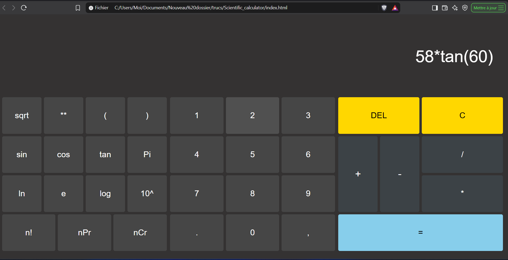

# Scientific Calculator

A scientific calculator built with plain HTML, CSS and JavaScript, with no framework and no dependency. It runs entirely in the browser.



## Features

- Basic operations: addition, subtraction, multiplication, division
- Powers (`^`), powers of ten (`10^`) and square root (`sqrt`)
- Logarithms: natural (`ln`) and base 10 (`log`)
- Trigonometry in **degrees**: `sin`, `cos`, `tan`
- Constants: π and e
- Combinatorics: factorial (`n!`), permutations (`nPr`) and combinations (`nCr`)
- Parentheses, decimal point, `DEL` (delete last item) and `C` (clear all)
- Keyboard input: digits and operators, `Enter` to calculate, `Backspace` to delete, `Escape` to clear
- Rounding of floating-point noise (for example `cos(90)` gives `0`)

## Usage

1. Clone or download this repository:
   ```
   git clone https://github.com/LucAttisso/scientific-calculator-.git
   ```
2. Open `index.html` in any modern browser. No installation is needed.

Examples:

| Input | Result |
|---|---|
| `sin(30)` | `0.5` |
| `sqrt(9)` | `3` |
| `fact(5)` | `120` |
| `nPr(5,3)` | `60` |
| `nCr(5,3)` | `10` |

For `nPr` and `nCr`, type the two numbers separated by a comma, then close the parenthesis.

## How it works

- Each button carries `data-*` attributes. `data-value` is what the screen shows, and `data-eval` is the JavaScript expression used for the calculation (for example `sin(` is displayed, but `sinDeg(` is evaluated).
- The input is stored as a list of tokens. The screen is rebuilt from this list after every change, so the display and the calculation can never get out of sync, and `DEL` removes a whole function name in one step.
- The layout uses CSS Grid, split into three blocks: scientific functions, numbers and operations.

## Project structure

```
.
├── index.html   # structure of the calculator
├── style.css    # layout and colors
└── script.js    # calculation logic and keyboard support
```

## Known limitations

- The result is computed with `eval()`. This is acceptable for a local learning project where the input only comes from the calculator's own buttons, but a dedicated expression parser would be a safer improvement.
- Some invalid operations (such as `1/0`) return `Infinity` instead of an error message.

## Technologies

- HTML5
- CSS3 (Grid)
- JavaScript (ES6)

## Author

Made by [LucAttisso](https://github.com/LucAttisso) as a learning project.
